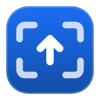

  

# SaveShot

SaveShot is a privacy-first, lightweight Chrome extension for capturing, annotating, redacting, and downloading screenshots locally right away with no sign-in required, or autosaving straight to your Google Drive with instant share links. Everything runs in Chrome with no external servers, no tracking, and no external dependencies.

## What it does

- **Select area or full tab**: Drag a box over any part of a page to crop just that section, press `Enter` to capture the full tab, or capture the visible tab in one click.
- **Customizable keyboard shortcuts**: Trigger area selection or visible-tab capture from the keyboard, and customize your preferred keys anytime at `chrome://extensions/shortcuts`.
- **Works locally or autosaves to your Drive**: Capture, edit, and download PNGs locally right away without signing in, or connect Google Drive once to autosave to `Chrome_SaveShot_ScreenShots` (customizable in Settings) with the share link copied automatically.
- **Built-in lightweight editor**: Opens automatically in a new tab so you can rename the file, add arrows, boxes, circles, lines, freehand strokes, text, solid black pixel redactions, custom hex colors, rotate or flip, click **Download** to save a PNG on your computer, or click **Save** (or **Save to Google Drive**) to upload and keep your share link.
- **Recent history**: Keeps your last 8 Google Drive screenshots in the popup for quick access, and clears them automatically when you sign out.
- **Local save backup**: If your Google Drive is full or your internet drops after taking a screenshot, a **Save PNG locally** button appears so you do not lose the image.
- **Strict privacy & narrow permissions**: Uses only `activeTab` and Google's narrow `drive.file` scope. SaveShot runs in Chrome with zero requests to any private or third-party server, and cannot access any other files in your Google Drive.

## Reporting bugs or requesting features

Click **Help** or **Report bug** inside SaveShot to copy your version info in one click and report an issue or request a feature on the [Chrome Web Store Support page](https://chromewebstore.google.com/detail/eilmbilnlihhddjdmdpppalfnbnieppf/support) or on [GitHub Issues](https://github.com/simplyakm/saveshot/issues).

## Privacy & Terms

SaveShot runs in your browser with no external or middleman servers. When you connect Google Drive, screenshots upload directly from Chrome to Google's official Drive API (`https://www.googleapis.com`) under your own account. There are no SaveShot servers, no analytics, and no tracking, and SaveShot can only access the screenshots and folder it creates. See [PRIVACY.md](PRIVACY.md) and [TERMS.md](TERMS.md) for details.

## License

Apache License 2.0. See [LICENSE](LICENSE) for details.
